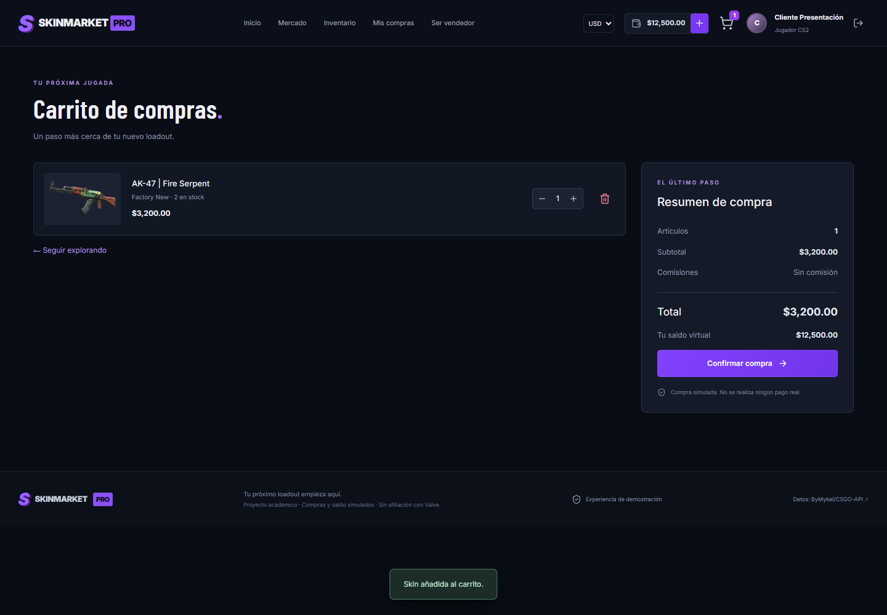
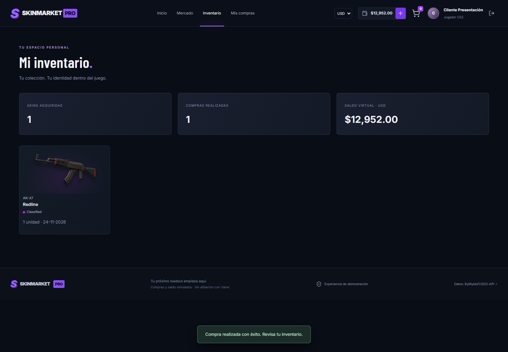
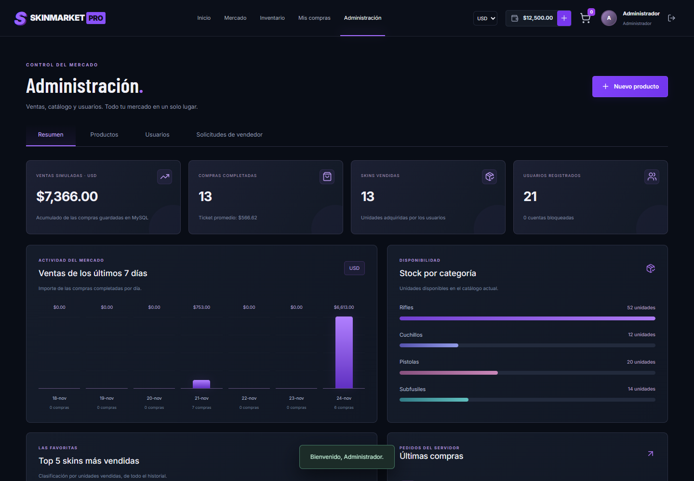
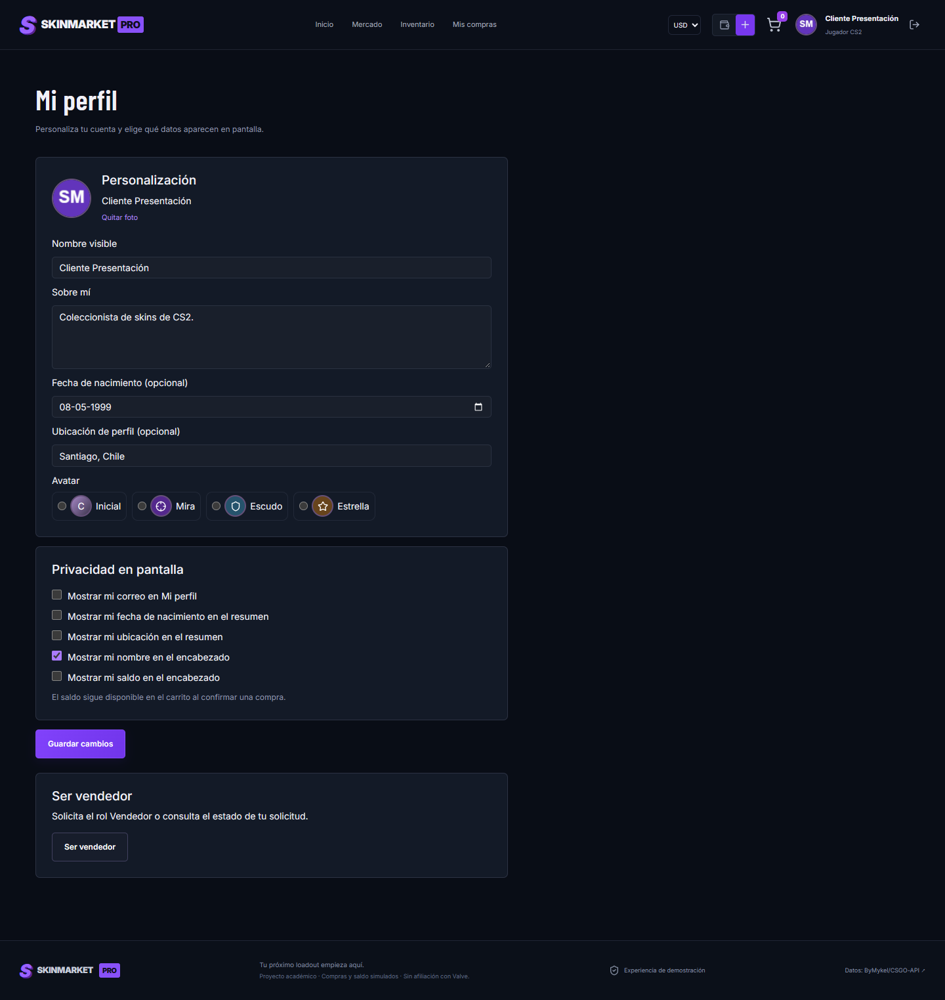

# Manual de usuario de SkinMarket

## Acceso

Abrir la dirección publicada o http://localhost:8080 en el equipo donde se ejecuta Docker. Home presenta skins destacadas; Mercado muestra el catálogo. Se pueden filtrar por texto, tipo de arma, rareza, colección, exterior y precio, además de ordenar. El selector USD/CLP cambia la presentación a una tasa académica fija de 950 CLP por USD.

**Figura 1. Inicio y catálogo**

Nota. Desde la portada se puede explorar el mercado y abrir el detalle de una skin.

## Registro e inicio de sesión

Seleccionar Acceder y Crear cuenta. Ingresar nombre de al menos tres caracteres, correo válido y contraseña de al menos seis caracteres, con máximo 72 bytes UTF-8. Los errores aparecen junto al campo. El servidor también revisa correo único. Al registrar, la cuenta recibe 12.500 USD virtuales y entra como CLIENTE. Para volver, usar correo y contraseña en Iniciar sesión.

**Figura 2. Validaciones del registro**

Nota. Los mensajes indican cómo corregir cada campo antes de crear la cuenta.

La sesión se recupera al recargar mediante una cookie protegida y un token renovado. Las compras se guardan en MySQL y están disponibles al ingresar a la misma cuenta desde otro equipo. La preferencia de moneda pertenece al navegador.

## Compra e inventario

Pulsar Añadir al carrito en una skin con stock. Abrir el carrito, aumentar/reducir cantidades o quitar artículos. Revisar total y saldo antes de Confirmar compra. Si falta stock o saldo, no se permite completar la compra. La billetera permite recarga de saldo virtual; no realiza cargos reales.

**Figura 3. Carrito**

Nota. Revisa cantidades, saldo y total antes de confirmar.

Al confirmar, las skins aparecen en Inventario y el pedido en Mis compras. El servidor calcula el total y actualiza saldo y stock junto con el pedido. Los registros de compras conservan los datos de la skin aunque el administrador la retire después.

**Figura 4. Inventario tras una compra**

Nota. La skin adquirida queda disponible en el inventario.

## Administración

Ingresar con una cuenta ADMIN. Las credenciales del administrador inicial se configuran de forma privada en el servidor. Administración contiene Resumen, Productos y Usuarios. Resumen muestra ventas, compras, unidades, stock y gráficos calculados a partir de pedidos guardados.

**Figura 5. Resumen administrativo**

Nota. El panel calcula sus indicadores a partir de las compras guardadas.

En Productos, usar Nuevo producto, completar el formulario y guardar. Editar permite cambiar información, precio y stock; Eliminar pide confirmación y retira la skin del catálogo. Los precios no pueden ser negativos y el stock debe ser entero mayor o igual a cero.

En Usuarios, crear cuentas, buscar por nombre o correo, filtrar rol/estado, editar perfil y rol, bloquear/desbloquear o eliminar cuentas sin compras. No es posible eliminarse, bloquearse o quitarse el propio rol ADMIN. No se visualizan contraseñas.

**Figura 6. Gestión de usuarios**

Nota. El administrador consulta y gestiona el estado de las cuentas.

## Postular a vendedor

Con una cuenta de cliente, abre **Mi perfil** desde el avatar del encabezado y selecciona **Ser vendedor**. Explica por qué quieres obtener el rol e indica si estudias, país, estado o región y ciudad. Añade experiencia, institución educativa o código postal si corresponde. Selecciona **Enviar solicitud**. Vuelve a la misma vista y selecciona **Actualizar estado** para consultar la decisión.

**Figura 7. Formulario de postulación**

Nota. El formulario reúne el motivo, la información de estudios y la ubicación para la revisión administrativa.

Con una cuenta ADMIN, abre **Administración → Solicitudes de vendedor**. Revisa los datos y selecciona **Aprobar** o **Rechazar**. Si rechazas, indica el motivo. El cliente puede leerlo y volver a postular.

**Figura 8. Revisión administrativa**

Nota. El administrador puede abrir el formulario y registrar su decisión.

Cuando la solicitud se apruebe, selecciona **Abrir panel de vendedor**. Usa las pestañas Productos y Órdenes para consultar sus listados. Abre una skin o selecciona **Ver detalle** en la orden que quieras consultar. El panel es de solo lectura.

**Figura 9. Detalle de orden en la vista de vendedor**

Nota. El detalle muestra la fecha, los artículos y el total de la orden.

## Uso móvil y errores

En móvil, abrir el menú superior y usar Filtros para desplegar las opciones. Las tablas de administración permiten desplazamiento horizontal dentro de su contenedor. Si no hay conexión con la API, aparece un aviso con Reintentar conexión. Un fallo no equivale a una compra confirmada: revisar Mis compras antes de repetir una acción incierta.

**Figura 10. Catálogo móvil**

Nota. Abre el menú y los filtros desde la barra superior.

## Mi perfil

Selecciona el avatar del encabezado para abrir Mi perfil. Pasa el mouse sobre el avatar de la sección Personalización o tócalo en el móvil para elegir una foto JPG, PNG o WebP de hasta 5 MB. También puedes elegir un avatar prediseñado. Edita tu nombre, biografía, fecha de nacimiento o ubicación y ajusta su visibilidad en pantalla. Selecciona **Guardar cambios** para conservar los ajustes.

**Figura 11. Personalización y privacidad**

Nota. Las preferencias se mantienen al volver a abrir la sesión.

## Recargar la billetera

Pulsa el botón de saldo en el encabezado. Cada opción indica el saldo virtual que recibirás y el precio simulado en USD y CLP. Elige un paquete y pulsa **Añadir saldo virtual**. Si el precio cambia mientras el modal está abierto, elige nuevamente con el precio actualizado.

**Figura 12. Opciones de recarga**

En **Administración → Recargas**, cambia el precio en USD de un paquete y pulsa **Guardar precio**. El cambio se guarda en MySQL. La cantidad de saldo del paquete se mantiene fija y la tienda usa la tasa de 950 CLP por USD para mostrar el equivalente.

## Alcance

Las skins, los precios y el saldo tienen finalidad académica. No se integran Steam, inventarios reales ni pasarelas bancarias. El laboratorio debe estar activo para que el enlace público funcione.
